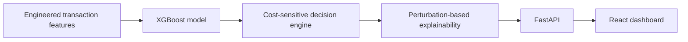

# ReturnGuard

ReturnGuard helps fraud operations teams turn transaction risk scores into cost-aware, explainable actions for approval, human review, or escalation.


## What this does

ReturnGuard evaluates a transaction and estimates its fraud risk. It then compares the expected cost of approving, reviewing, or escalating that transaction and recommends an action. The API also returns the factors that increased or reduced the model's risk estimate so an investigator can understand the result. A React dashboard presents the inputs, recommendation, costs, and explanation in one place.

## Key design decisions

- The dataset is ordered by `TransactionDT` and divided with a temporal 60/20/20 train, validation, and test split.
- Target-derived `customer_fraud_rate` is excluded. Customer deviation uses an expanding historical mean with `shift(1)` so future transactions do not influence earlier predictions.
- The XGBoost probability feeds a cost-sensitive decision engine that compares the expected loss of `APPROVE`, `HUMAN_REVIEW`, and `ESCALATE`.
- A safety rule prevents autonomous approval when the model assigns a `HIGH` risk band. Those transactions are escalated for human oversight.
- Local explanations use feature perturbation because the intended SHAP workflow was incompatible with NumPy 2.x and XGBoost 3.4.1 in the project environment.

## Model performance

The models were evaluated on the same corrected feature set. Classification thresholds for Logistic Regression and XGBoost were selected on validation data and then applied to the test set without further tuning.

| Model | Validation F1 | Test F1 | ROC AUC (validation / test) |
| --- | ---: | ---: | ---: |
| Rule-based | ≈0.006 | 0.000 | ≈0.50 / ≈0.50 |
| Logistic Regression | ≈0.20 | ≈0.13 | ≈0.73 / ≈0.70 |
| XGBoost | ≈0.30 | ≈0.17 | ≈0.81 / ≈0.76 |

The test split is the strongest indication of current generalization. XGBoost reaches a test ROC AUC of approximately 0.76 and a test F1 of approximately 0.17 on this imbalanced dataset.

## Architecture overview



The model uses 48 engineered features, including transaction amount, time, customer amount deviation, card and address attributes, email domains, and anonymized IEEE-CIS V features. The trained model artifact is loaded once when the API starts.

## API endpoints

The FastAPI service runs at `http://127.0.0.1:8000`.

| Method | Endpoint | Purpose |
| --- | --- | --- |
| `GET` | `/health` | Check whether the API is running |
| `POST` | `/predict` | Run prediction, decision, and explanation for one transaction |

All prediction fields are optional at the schema level. Any omitted model feature defaults to `0.0` during inference.

Example request:

```bash
curl -X POST http://127.0.0.1:8000/predict \
  -H "Content-Type: application/json" \
  -d '{
    "TransactionAmt_raw": 250,
    "TransactionAmt_log1p": 5.525453,
    "hour_of_day": 14,
    "day_of_week": 3,
    "is_high_value": 0,
    "txn_deviation_from_customer_avg": 100,
    "V_V29": 0,
    "V_V37": 0,
    "V_V30": 0,
    "V_V35": 0
  }'
```

Example response from the current model:

```json
{
  "risk_score": 0.18589721620082855,
  "risk_band": "LOW",
  "recommended_action": "HUMAN_REVIEW",
  "expected_costs": {
    "approve": 139.4229,
    "review": 100.0,
    "escalate": 203.5257
  },
  "top_risk_factors": [
    { "feature": "card5", "contribution": 0.14552001655101776 },
    { "feature": "card3", "contribution": 0.09616728127002716 },
    { "feature": "card6", "contribution": 0.06344247609376907 },
    { "feature": "R_emaildomain", "contribution": 0.10783710330724716 },
    { "feature": "addr2", "contribution": 0.11733308434486389 }
  ],
  "top_protective_factors": [
    { "feature": "txn_deviation_from_customer_avg", "contribution": 0.05732698738574982 },
    { "feature": "dist1", "contribution": 0.03738522529602051 },
    { "feature": "V_V19", "contribution": 0.027608856558799744 },
    { "feature": "addr1", "contribution": 0.04664389789104462 },
    { "feature": "TransactionAmt_raw", "contribution": 0.061950042843818665 }
  ],
  "transaction_amount": 250.0
}
```

Interactive API documentation is available at `http://127.0.0.1:8000/docs` while the backend is running.

## Setup

### 1. Clone the repository

```bash
git clone https://github.com/Kanha-Gupta18/returnguard.git
cd returnguard
```

### 2. Create a Python environment and install dependencies

```bash
python -m venv .venv
```

Activate the environment:

```bash
# macOS or Linux
source .venv/bin/activate

# Windows PowerShell
.venv\Scripts\Activate.ps1
```

Install the backend dependencies:

```bash
python -m pip install -r requirements.txt
```

### 3. Start the API

Run this command from the repository root:

```bash
python -m uvicorn api.main:app --host 127.0.0.1 --port 8000
```

Confirm the service is available at `http://127.0.0.1:8000/health`.

### 4. Start the dashboard

Open a second terminal:

```bash
cd dashboard/frontend
npm install
npm run dev
```

Open `http://127.0.0.1:5173`. The Vite development server proxies dashboard requests from `/api` to the backend on port 8000.

## Current status

- ✅ Baseline models trained with proper train, validation, and test separation
- ✅ Feature engineering pipeline with target leakage removed
- ✅ Cost-sensitive decision engine
- ✅ Perturbation-based explanation layer
- ✅ FastAPI backend with `/health` and `/predict`
- ✅ React dashboard with transaction input and prediction results
- ✅ Git repository initialized

## Roadmap

- Improve ranking and classification performance, with a focus on test ROC AUC and F1 under temporal distribution shift.
- Deploy the API and dashboard to Railway or Render for a public demonstration.
- Add a reproducible model retraining pipeline with artifact versioning and evaluation gates.
- Expand the input pipeline to cover more fraud signal types while preserving prediction-time availability and leakage checks.

## License

ReturnGuard is available under the [MIT License](LICENSE).
