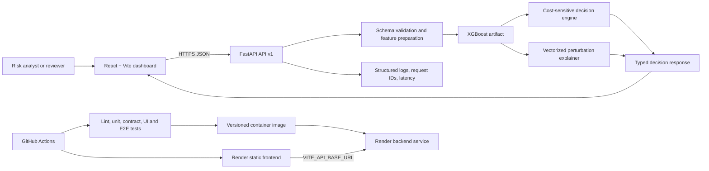

# ReturnGuard end-to-end build plan

## 1. Target outcome and assumptions

ReturnGuard will become a public, recruiter-ready web application that demonstrates a complete transaction-risk decision path: validated input, XGBoost inference, cost-sensitive action selection, human-readable evidence, automated verification, and a repeatable deployment.

The first release is deliberately a stateless demonstration system. It will not store personal transaction data, process payments, make production financial decisions, or claim regulatory compliance. Accounts, persistent cases, analyst assignments, and enterprise audit exports remain a later production-pilot track.

The primary user is assumed to be a fraud or risk analyst reviewing one transaction before fulfillment. Recruiters and engineers are the secondary evaluation audience. These assumptions are recorded in `PRODUCT.md` and should be corrected before Stage 1 if the intended audience differs.

## 2. Current build audit

**Production audit: 54/100, risky.** The core local path works, but the repository does not yet provide a reproducible, tested, observable, or deployable release.

### Working evidence

- The React production build passes with Vite 8.2.2.
- The frontend lint command passes with Oxlint.
- A direct end-to-end prediction succeeds against the checked-in XGBoost artifact.
- The measured cold in-process prediction took approximately 4.2 seconds on the current machine.
- The API already separates inference, decisioning, and explanations.
- The decision engine preserves the safety rule that HIGH risk cannot produce APPROVE.
- The frontend has initial, loading, error, success, and stale-result behavior.

### Release blockers

| Priority | Finding | Consequence | Planned fix |
| --- | --- | --- | --- |
| P0 | No committed automated test suite or CI workflow | Regressions can reach `main` without evidence | Commit focused backend, API, frontend, and E2E tests; add GitHub Actions |
| P0 | No Dockerfile, deployment manifest, environment example, or rollback procedure | A clean public deployment cannot be reproduced | Add a pinned runtime, containers, Render blueprint, environment validation, and rollback notes |
| P0 | `/health` returns `ok` even when model loading fails | A deployment can appear healthy while predictions return 503 | Split liveness and readiness; readiness must verify the artifact and model metadata |
| P0 | Model paths are relative to the process working directory | Startup depends on where the command is launched | Resolve artifact paths from the package/repository root and validate at startup |
| P1 | Python dependencies are unpinned and include an incompatible, unused SHAP path | Fresh installs are not reproducible and current broad test discovery fails under NumPy 2.x | Define supported Python, lock runtime/dev dependencies, and remove SHAP from runtime unless it becomes compatible and used |
| P1 | The checked-in `.gitignore` contains literal `\n` text | Ignore rules do not work as intended | Rebuild the file with real lines and verify ignored paths |
| P1 | 97 generated cache or dependency files are tracked, including 86 files under `dashboard/node_modules` | Repository size and diffs are noisy and unsafe to maintain | Remove generated files from Git tracking while leaving local installations intact |
| P1 | Local tests and debug scripts are untracked and several are stale or syntactically invalid | `pytest` fails during collection and local evidence cannot be trusted | Triage useful tests, delete or archive experiments, and make test discovery explicit |
| P1 | CORS is hard-coded for port 3000 while the app uses Vite on 5173 | Split deployments will fail unless traffic happens through the local proxy | Read allowed origins from validated environment settings |
| P1 | Request fields are broadly optional and missing values silently become zero | Invalid or incomplete requests can look like valid model input | Define a small public input contract, compute derived values server-side, and reject invalid ranges |
| P2 | Startup and schema code use deprecated FastAPI/Pydantic patterns | Future upgrades will break with avoidable migration work | Use FastAPI lifespan and Pydantic v2 validators |
| P2 | There are no request IDs, structured logs, latency metrics, or model-version data | Failures and slow predictions are hard to diagnose | Add privacy-safe structured logs and expose build/model metadata |
| P2 | The frontend is concentrated in one component and has no component or E2E tests | UI changes are harder to review and verify | Split only by product responsibility and add interaction tests |

### Evidence boundaries

- `main` is currently aligned with `origin/main` at `18d5135` before the new planning files.
- The working tree already contained an unrelated `.gitignore` edit and many untracked data, evaluation, test, output, and tool files. The plan does not treat those files as committed product capability.
- Live HTTP browser inspection was blocked by the local sandbox socket policy, so the current UI assessment uses source inspection, a successful production build, and direct in-process inference. Browser-level verification is a required later gate.

## 3. Release feature set

### User-facing launch scope

1. **Transaction analyzer**
   - Curated input fields with units, ranges, and plain-language help.
   - Three synthetic presets that exercise low, medium, and high-risk paths.
   - Advanced model fields remain available behind progressive disclosure when needed.
   - Clear validation before any request is sent.

2. **Decision result**
   - Recommended action is the primary result: APPROVE, HUMAN REVIEW, or ESCALATE.
   - Risk score and risk band are displayed together without implying certainty.
   - Expected cost for each action explains why the policy chose its recommendation.
   - Risk-increasing and protective factors use readable labels and actual contribution values.
   - A compact decision trace shows `input → model → policy → action`.

3. **Trust and recovery states**
   - Initial guidance, validation, loading skeleton, success, stale-result, timeout, API-offline, and unexpected-error states.
   - Service and model readiness status in the interface.
   - Model version, dataset source, evaluation method, and limitations presented without inflated claims.

4. **Technical proof**
   - Accessible links to API documentation, repository, model card, and architecture notes.
   - Copyable request and response examples using synthetic data.

### Service scope

- `GET /health/live`: confirms that the web process is running.
- `GET /health/ready`: confirms model artifact load, expected feature contract, and model metadata.
- `GET /api/v1/meta`: returns safe build, model, feature-contract, and policy versions.
- `POST /api/v1/predict`: validates a transaction and returns the decision contract.
- Existing `/health` and `/predict` routes remain as documented compatibility aliases during the migration, then can be removed in a later breaking release.
- Requests receive a correlation ID, bounded payload size, timeout handling, and privacy-safe logs.
- A basic public-demo rate limit and bounded inference concurrency protect the CPU-heavy explanation path.

### Explicitly outside the first release

- Real payment processing or payment-provider integration.
- Storage of customer or cardholder data.
- Multi-tenant accounts, analyst permissions, or case assignments.
- Automatic blocking or approval of real transactions.
- Online learning or model retraining from the dashboard.
- Compliance, accuracy, or loss-reduction claims not supported by repository evidence.

## 4. Target architecture



### Repository boundaries

```text
api/                 HTTP routes, settings, lifespan, schemas, middleware
returnguard/         Pure application services for features, inference, decisions, explanations
models/              Versioned inference artifact plus metadata/checksum
dashboard/frontend/  React application organized by feature, not by generic component type
tests/               Python unit, contract, invariant, and integration tests
e2e/                 Playwright launch-critical browser tests
scripts/             Verified maintenance and model-pipeline entry points
docs/                Architecture, model card, deployment, operations, and decisions
```

The exact package move is conditional on Stage 1 findings. Working code will not be relocated merely to match the diagram; boundaries will be introduced only where they reduce import and test ambiguity.

### Deployment model

- Python 3.12 and Node 22 are the supported release runtimes. XGBoost 3.4.1
  requires Python 3.12 or newer, and Python 3.12 keeps the release on a stable,
  widely supported deployment baseline.
- The frontend deploys as a static Render service.
- The API deploys from a small, non-root Docker image on Render.
- `render.yaml` defines both services and their health checks.
- Local development uses the same environment names, plus an optional Docker Compose path.
- The model artifact is bundled with the API image, verified by checksum, and never downloaded at request time.
- Rollback is a redeploy of the previous immutable image and static build.

## 5. Engineering and product guidelines

### Behavioral invariants

- HIGH risk must never resolve to APPROVE.
- The model score and the policy action stay separate in code and presentation.
- Derived fields are computed in one shared server-side feature-preparation path.
- Explanations must use the same transformed row and model artifact as the score.
- The API never exposes stack traces, filesystem paths, secrets, or raw personal data.
- A failed or mismatched artifact makes readiness fail; it does not degrade silently.

### Implementation discipline

- State assumptions before changing behavior.
- Prefer the smallest change that produces observable value.
- Keep pure decision and feature functions independent from FastAPI and React.
- Add abstractions only when two real call sites or a clear boundary justify them.
- Every behavior change includes a focused test; avoid tests that simply mirror implementation.
- Record material choices in short architecture decision records.
- Each stage is one reviewable branch or pull request with a rollback note.
- Preserve existing user work in the dirty working tree; never sweep untracked files into a commit.

### UI and content rules

- This is an Operate surface: scanability, consistency, native controls, and clear states outrank novelty.
- Use one restrained accent for primary actions and selection. Risk colors are semantic and never the only signal.
- Keep typography compact and stable; use tabular numerals for scores and costs.
- Every control has default, hover, focus-visible, active, disabled, loading, and error treatment.
- Use skeletons for result loading and instructional empty states before the first analysis.
- Motion communicates state in 150–220 ms. Use opacity and transform, disable nonessential motion under `prefers-reduced-motion`, and do not choreograph page load.
- Maintain WCAG 2.2 AA contrast, keyboard access, logical focus order, explicit labels, and live-region status updates.
- Use synthetic, visibly labeled examples. Do not imply that demo data represents real customers.

## 6. Design direction

### Design read

ReturnGuard is a trust-first analyst workspace for a high-consequence decision. It should feel like a modern financial control sheet: compact, legible, calm under pressure, and explicit about how evidence becomes an action.

Design dials: **variance 4/10**, **motion 2/10**, **density 7/10**.

### Proposed world: Decision Docket

The interface treats each analysis as a structured decision record rather than a collection of unrelated cards. A narrow status rail establishes service and model readiness. The main workspace pairs a concise transaction sheet with a dominant result docket. A vertical trace joins model score, risk band, policy cost comparison, and final human action so the product's unique mechanism is visible in one viewport.

The concept borrows the discipline of financial ledgers and operational dispatch sheets: stable columns, precise rules, clear status stamps, and a record that changes state without disappearing. It avoids nostalgic styling, ticket-shaped decoration, and coded labels that make an analyst decode the interface.

### Design set

| Role | Decision |
| --- | --- |
| Canvas | `#F5F7FA`, with a quiet cool cast |
| Primary surface | `#FFFFFF` |
| Secondary surface | `#EEF2F6` for rails, grouped controls, and skeletons |
| Ink | `#101828` |
| Muted text | `#667085` |
| Hairline | `#D8DEE8` |
| Primary action | `#2457E6`; reserved for submit, selection, and focus |
| Low risk | `#18794E` plus icon and text label |
| Medium risk | `#B25E09` plus icon and text label |
| High risk | `#C43232` plus icon and text label |
| Type | A neutral UI sans with system fallback; tabular figures and a restrained monospace utility style for IDs and raw fields |
| Radius | 8 px controls, 12 px major surfaces; no pill-shaped general controls |
| Elevation | Borders for structure; one shallow shadow only for overlays or the active result surface |
| Spacing | 4 px base, with 8/12/16/24/32 px working steps |
| Content width | Fluid desktop workspace with a readable 1440 px maximum; structural collapse below tablet widths |

### Layout and responsive behavior

- Desktop: compact top bar, 220 px navigation/status rail, transaction pane, and a wider decision pane.
- Tablet: rail collapses to a horizontal status strip; input and result remain side by side where readable.
- Mobile: input precedes result, primary action becomes full width, raw/advanced fields use disclosure, and no horizontal scrolling is required.
- The final action, risk band, score, and decision trace stay above the fold on common laptop widths after a result is available.

### State inventory

- Service checking, ready, degraded, and offline.
- Form pristine, dirty, invalid, submitting, and timed out.
- Result absent, loading, low, medium, high, stale, and failed.
- Factor lists populated, partially available, and unavailable.
- Narrow layout, long labels, keyboard focus, reduced motion, and high browser zoom.

### Reference ledger

Refero was invoked for four style searches and three product-screen searches, but the connector returned `NO_SUBSCRIPTION` for every query. Its research method was retained, while the visual fallback used public product evidence from:

- Stripe Radar: centralized fraud workspace, decision outcomes, risk insights, and rule analytics — <https://stripe.com/blog/new-radar-features>
- Stripe risk evaluation: score, band, outcome, and reason are presented as separate concepts — <https://docs.stripe.com/radar/risk-evaluation>
- Sift: analyst efficiency, visible signals, and control over decisions — <https://sift.com/>
- Alloy: unified risk signals, decisioning, investigation context, and auditability — <https://www.alloy.com/fraud>

Impeccable's direction roll was also run. The Japanese high-density reference was competitive for its hairline grid, compact modules, and minimal motion; the jet-age ticket-wallet reference was competitive for its explicit state stamps and durable records. Their structural discipline is retained without copying their brand styling. Data-sublime, coded-label, dance-notation, and mascot references were declined because they reduce product clarity or conflict with the calm financial context.

## 7. Implementation stages and approval gates

Each stage ends with a working demonstration, verification evidence, changed-file list, known limits, and branch/commit status. Work stops for review and explicit approval before the next numbered stage.

### Stage 1 — Repository and runtime foundation

**Depends on:** approval of this plan.

**Work:** repair `.gitignore`; remove generated files from tracking; classify existing untracked work without deleting it; define Python/Node versions; create reproducible runtime and development dependency sets; add environment examples and basic developer commands; resolve artifact paths safely.

**Verification:** fresh environment install, import check, frontend lint/build, direct prediction, clean Git tracking audit.

**Rollback:** revert the single foundation commit; local untracked files remain untouched.

### Stage 2 — Backend contract and reliability

**Depends on:** Stage 1.

**Work:** add settings, lifespan loading, liveness/readiness, model metadata/checksum, versioned API routes, strict input validation, consistent error responses, request IDs, structured logging, concurrency/rate protection, and vectorized perturbation inference with equivalence tests.

**Verification:** unit and contract tests; safety-invariant property tests; startup with valid, missing, and mismatched artifacts; latency benchmark; compatibility-route tests.

**Rollback:** keep compatibility endpoints and revert the v1 service commit if deployment smoke checks fail.

### Stage 3 — Dashboard redesign

**Depends on:** stable Stage 2 contract and explicit approval of the Decision Docket direction.

**Work:** establish tokens; split the analyzer by product responsibility; add presets, validation, service status, decision trace, costs, explanations, model limits, and complete UI states; implement responsive and reduced-motion behavior.

**Verification:** frontend lint/build, component interactions, keyboard pass, axe accessibility pass, 1440 px and 390 px visual inspection, real API low/medium/high flows, Impeccable detector and finish review.

**Rollback:** the API remains compatible with the existing dashboard; revert the UI commit without touching model behavior.

### Stage 4 — Release verification and CI

**Depends on:** Stages 2 and 3.

**Work:** commit the curated Python suite; add Vitest/Testing Library and Playwright; add GitHub Actions for dependency install, lint, unit, contract, build, and one launch-critical E2E path; add dependency and secret scanning using pinned actions.

**Verification:** CI passes from a clean checkout and the browser test exercises a real API response, stale-result recovery, and an error state.

**Rollback:** remove the workflow commit without changing runtime behavior; tests remain runnable locally.

### Stage 5 — Deployment and operations

**Depends on:** green Stage 4 CI.

**Work:** add Dockerfile, `.dockerignore`, Render blueprint, production CORS/environment configuration, health checks, log fields, deploy/rollback runbook, and a smoke-check script.

**Verification:** local container build; production-like container smoke; public frontend-to-API prediction; readiness failure test; redeploy previous image as a rollback drill.

**Rollback:** redeploy the prior image/static build through Render and restore the previous environment group.

### Stage 6 — Model pipeline and recruiter evidence

**Depends on:** stable deployed release.

**Work:** turn useful local evaluation work into a documented, reproducible training/evaluation path; validate expected IEEE-CIS input files; record seeds, split rules, metrics, artifact checksum, and model card; update README screenshots and architecture/deployment documentation.

**Verification:** reproduce metrics from documented inputs within stated tolerances; rebuild the model artifact; run regression and API tests against it; confirm README commands from a clean clone.

**Rollback:** retain the previous versioned artifact and model metadata; deployment can pin the prior model checksum.

## 8. Definition of done

- A clean clone installs and runs with documented, pinned runtimes.
- All launch-critical tests pass locally and in GitHub Actions.
- The dashboard completes low, medium, and high synthetic transaction flows against the real API.
- Health checks accurately distinguish process health from model readiness.
- The public deployment has working CORS, environment configuration, logs, rate/concurrency protection, and a tested rollback path.
- The UI is responsive, keyboard usable, screen-reader coherent, and reduced-motion safe.
- Model metrics, limitations, dataset provenance, and artifact identity are documented and reproducible.
- No generated dependency folders, caches, raw datasets, secrets, or personal data are tracked.
- Repository, API, UI, and deployment documentation describe the behavior that actually ships.

## 9. Decisions required before Stage 1

The plan can proceed with the recorded defaults unless corrected:

1. Optimize the first release for a **recruiter-ready public demo**.
2. Treat a **risk analyst** as the primary product user.
3. Use the **Decision Docket** visual direction with calm fintech precision.
4. Deploy the static frontend and containerized API on **Render**.
5. Keep the first release **stateless and synthetic-data only**.
